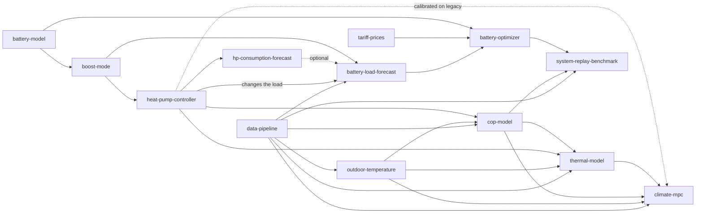

# Component calibration records

Every model, forecast, parameter set and benchmark in this repository holds only for the data and the
plant regime it was calibrated on. These pages record, per component, **what it was calibrated on, what
it assumes and what invalidates it**, so that a change in the house or in a control rule leads to a
concrete recalibration instead of a silent drift. They are the *calibration record*; the forward-looking
roadmaps stay in [`planning/components/`](../planning/components/) and the architecture in
[architecture](../architecture.md#planning-components).

The reason in one sentence: the battery optimizer was validated on load that contains the legacy
cheapest-hours heat-pump behaviour, so once the heat pump runs a comfort schedule (see [ADR-0006](../adr/0006-decouple-heat-pump-comfort-from-battery-price-optimisation.md)) every result that depends on that load is stale until it is recalibrated.

## How to use these pages

When anything changes (a setting in the house, an AppDaemon rule, a sensor, a tariff term, a battery
parameter, the code of a component):

1. **Update the [regime log](regime-log.md)** with the date and the exact change (mark an unverified date
   as such). Planned changes live there too, as `planned`.
2. **Follow the dependency map** below from the changed component to every consumer, and read each
   consumer's *Invalidated when* section.
3. **Recalibrate or mark stale.** Either run the page's *Recalibrate by* command and meet its acceptance
   check, or set the status to `stale` in the table below and on the page, with the date and the reason.
   Never leave a calibrated claim standing on a regime it was not calibrated on.
4. Evaluation windows after a regime change exclude a settling period (28 days for the 28-day load
   forecast) and any alternating-arm field-trial weeks; say so in the result.

A pull request that changes a component or reflects a plant or control change does 1 to 3 in the same
change (rule in [AGENTS.md](../../AGENTS.md)).

## Page template

Every component page has the same sections, in this order, and stays at 30 to 60 lines:

| Section | Content |
|---|---|
| Purpose and owner | What it does; which repository owns it |
| Interfaces | Inputs, outputs, consumers |
| Calibrated on | Data window, plant regime, run id, dataset id, feature-set id, commit |
| Assumptions | Each with an evidence link |
| Invalidated when | Concrete triggers, not general worries |
| Recalibrate by | The exact command or analysis, and the acceptance check |
| Status | One of the values below, with date |

Statuses: **valid** (calibrated on the current regime), **provisional** (calibrated, but an acceptance
criterion fails or an input is an unconfirmed assumption), **stale** (the regime it was calibrated on is
gone or going), **parked** (deliberately not used), **planned** (not built).

Privacy: relative figures, unit parameters and content hashes only. No costs, savings, absolute household
energy totals, URLs, hostnames, coordinates or station ids.

## Dependency map

| Component | Consumers (stale-propagation targets) |
|---|---|
| [data-pipeline](data-pipeline.md) | every offline result; the shadow service history |
| [outdoor-temperature](outdoor-temperature.md) | cop-model, thermal-model |
| [heat-pump-controller](heat-pump-controller.md) | battery-load-forecast, cop-model, thermal-model, hp-consumption-forecast, system-replay-benchmark, climate-mpc |
| [cop-model](cop-model.md) | thermal-model replay, system-replay-benchmark (only through the legacy replay), climate-mpc |
| [thermal-model](thermal-model.md) | climate-mpc (offline replay only); nothing live |
| [hp-consumption-forecast](hp-consumption-forecast.md) | battery-load-forecast (optional) |
| [battery-load-forecast](battery-load-forecast.md) | battery-optimizer |
| [battery-model](battery-model.md) | battery-optimizer, boost-mode, system-replay-benchmark |
| [battery-optimizer](battery-optimizer.md) | system-replay-benchmark, the future battery actuator |
| [tariff-prices](tariff-prices.md) | battery-optimizer, boost-mode, every `dataset_id` |
| [boost-mode](boost-mode.md) | heat-pump-controller, battery-load-forecast |
| [system-replay-benchmark](system-replay-benchmark.md) | the decisions in the ADRs |
| [climate-mpc](climate-mpc.md) | the B3 comparison after winter; nothing live |

## Status (2026-10-31)

| Component | Status | Since | One-line reason |
|---|---|---|---|
| [data-pipeline](data-pipeline.md) | valid until battery go-live | 2026-10-31 | `build` reconstructs gross load and refuses the no-battery assumption from `battery.commissioned_at`; set it and the counter ids on install day |
| [outdoor-temperature](outdoor-temperature.md) | valid | 2026-10-30 | Debiased house sensor, fused series only fills long gaps |
| [heat-pump-controller](heat-pump-controller.md) | valid (legacy), being replaced | 2026-10-30 | Cheapest-hours rule is live; comfort controller designed 2026-10-31, merge gated on the battery ([design](../planning/comfort-controller-design.md)) |
| [cop-model](cop-model.md) | provisional | 2026-10-30 | Daily error passes, season error fails; trained on 26 to 28 degC water only |
| [thermal-model](thermal-model.md) | parked | 2026-10-30 | C2 UNDETERMINED, no model accepted |
| [hp-consumption-forecast](hp-consumption-forecast.md) | planned (LF-1 stale on rule retirement) | 2026-10-30 | Interface specified, not built; LF-1 replays the legacy rule |
| [battery-load-forecast](battery-load-forecast.md) | valid for the legacy regime, stale at go-live of the comfort schedule | 2026-10-30 | 28-day mean learns from legacy heat-pump hours |
| [battery-model](battery-model.md) | provisional | 2026-10-31 | RTE 0.80, SOC window and zero idle draw are assumptions; wear cost set to 0.01 from the sweep, to re-check on measured data |
| [battery-optimizer](battery-optimizer.md) | valid (shadow only) | 2026-10-31 | Objective unchanged by the decoupling; not go-live ready |
| [tariff-prices](tariff-prices.md) | provisional | 2026-10-30 | Taxes unconfirmed, holidays missing |
| [boost-mode](boost-mode.md) | planned | 2026-10-30 | Rule, thresholds and interlock not built; phase 2 after the comfort controller works |
| [system-replay-benchmark](system-replay-benchmark.md) | valid as recorded (legacy and transferred regimes) | 2026-10-30 | Replay B load shape was never the real comfort schedule |
| [climate-mpc](climate-mpc.md) | provisional (implemented, offline; shadow pending B2) | 2026-10-31 | Exploratory model (no thermal model accepted); planned figures are predictions, not outcomes |
